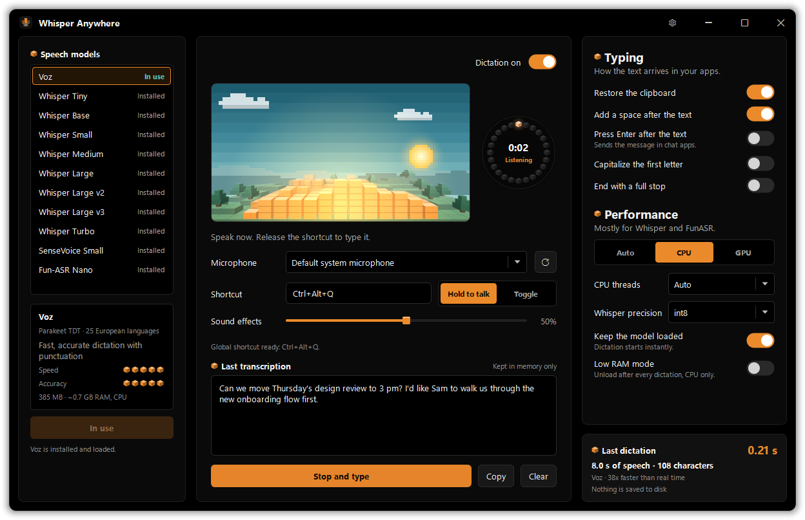
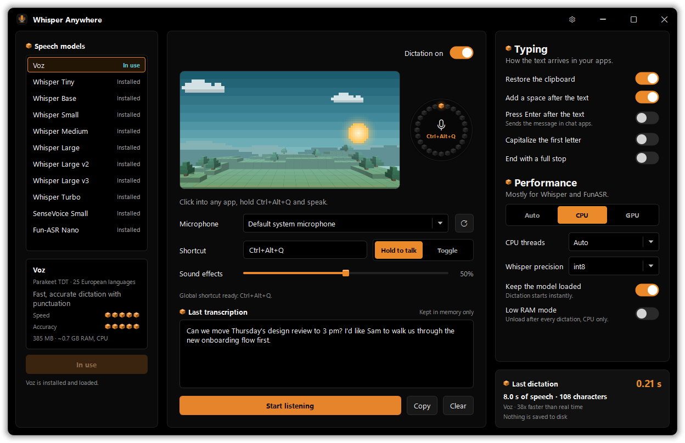
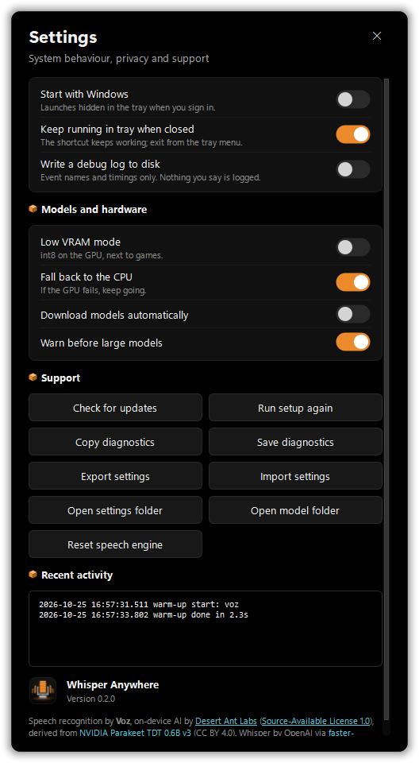

# Whisper Anywhere

Whisper Anywhere is a native Windows 11 desktop/tray app for local voice typing. It transcribes speech on your PC with a local speech model, Voz by default, then pastes the result into the app you were using.

Click in any app, hold `Ctrl + Alt + Q`, speak, release, and Whisper Anywhere transcribes your speech locally with the selected speech model.

This is not a web app and it does not use a cloud API. Recordings stay in memory and are never written to disk.



<table>
<tr>
<td></td>
<td width="34%"></td>
</tr>
</table>

## Download

**[Download WhisperAnywhere-Setup-0.2.0.exe](https://github.com/aSimpleLife-Lab/whisper-anywhere/releases/download/v0.2.0/WhisperAnywhere-Setup-0.2.0.exe)**: one installer, no administrator rights needed, Windows 10/11 64-bit.

1. Run the installer. The app is not code-signed yet, so Windows SmartScreen may say it "protected your PC": click **More info**, then **Run anyway**.
2. Start Whisper Anywhere from the Start menu.
3. Click into any app, hold `Ctrl + Alt + Q` (or the mouse button you pick), speak, and let go.

The app downloads speech models on first use (Voz is about 385 MB), so the first setup takes a little while.
To launch automatically after reboot, click the gear in the title bar and turn on **Start with Windows**.
The installer build includes Voz and every Whisper model. SenseVoice and Fun-ASR need the optional FunASR engine, which is too large to ship in the installer; build from source with FunASR installed to use them.

## Developer Update Log

<details>
<summary><strong>Current build - v0.2.0</strong> - Voz speech model, new interface, faster and more private</summary>

- **Voz** ([desert-ant-labs/voz](https://huggingface.co/desert-ant-labs/voz), NVIDIA Parakeet TDT 0.6B v3) is the new default model: punctuated, capitalized text in 25 European languages, on the CPU, no GPU needed
- Voz runs on ONNX Runtime with graphs rewritten for desktop CPUs (length-sized encoder windows, single-lane decoding, float32). On a Ryzen 9 5950X a 3 s clip transcribes in 0.12 s, 8 s in 0.2 s, 36 s in 0.9 s
- New interface with LumaDeck's layout in OLED black and orange: a frameless window with its own title bar, three panels that fit without scrolling, pill toggles, and a **voxel scene** that follows the time of day (pixel sun, moon in its real phase, voxel clouds and pines). Its front is a voxel equaliser: your voice raises glowing columns that roll back into the distance, and a cyan scanner runs while the model works. A voxel mic wheel shows the recording time, and the gear opens the settings window
- **Mouse buttons as the shortcut**: bind M3, M4 or M5 (or M1/M2 with a modifier, such as Ctrl+M1). The bound button is held back from other apps, so M4 starts dictation instead of going Back in the browser
- **Types into games**: in full-screen apps the text is typed in as characters instead of pasted, because most game chat boxes ignore Ctrl+V. Elsewhere the paste keys are held long enough for games that read the keyboard once per frame
- **New voxel sounds** made for the app (`scripts/make_cues.py`): the start cue lands a block and steps up a chiptune staircase with a chord sparkle and echo, the stop cue steps down and settles. A **Sound effects** slider sets their volume, and 0 turns them off
- **New voxel icon** for the app, taskbar, tray and installer, with hand-placed pixel art at 16 px (`scripts/make_icon.py`)
- **Fits any screen**: the window opens at its full size where there is room and fits smaller screens otherwise; on short screens the panels and the settings window scroll instead of squeezing and clipping text. Sharp at 125/150/200 % display scaling
- **Installer**: one setup .exe that installs per user without administrator rights
- The installed model now loads in the background at startup, so the first dictation is as fast as the rest
- Recordings stay in memory; nothing you say is written to disk or logged. Logs live in memory unless **Write a debug log to disk** is on, and pasted text is marked private so clipboard history and clipboard monitors skip it
- Fixed: Ctrl+letter shortcuts such as Ctrl+Shift+D never triggered, because Windows reports a control character instead of the letter while Ctrl is held
- Fixed: **Restore the clipboard** lost copied images and rich text, and could put the old clipboard back before slow apps (browsers, Electron apps) had pasted. It now restores every format a moment later, and only if you have not copied something new
- Fixed: the chosen microphone was remembered by device number, which changes when devices are plugged in, so dictation could record from the wrong one. It is now found by name
- Fixed: long dictations timed out after 90 s and lost their text; the limit now grows with the recording
- Fixed: typing a long text froze the window until it finished; it now types in the background
- Fixed: buttons in the settings window cut off the bottom of their labels
- Fixed: pasting while the shortcut's Alt/Shift/Win keys were still held sent Ctrl+Alt+V instead of Ctrl+V
- Fixed: **Press Enter after the text** pasted a newline instead of pressing Enter, so chat apps never sent the message
- Fixed: a silent tap of the shortcut unloaded the model, so the next dictation had to reload it
- Fixed: Whisper on the CPU used only 4 threads; Auto now uses one per physical core
- Faster pasting: no focus-restore delay when you never left the target app
- The microphone list shows each device once; Windows exposed every microphone up to four times
- **Dictation on** switch pauses and resumes the global shortcut without closing the app

</details>

<details>
<summary><strong>v0.1.1</strong> - setup, updates, microphone, diagnostics, and portable settings</summary>

- Proper native Windows app, taskbar, tray, and EXE icon
- Bundled custom start/stop feedback sounds
- Click-to-record shortcut selection, including single-key shortcuts
- Performance / Hardware settings save safely without breaking shortcuts
- Feature list dropdown inside the app
- Safer settings dropdowns that ignore mouse-wheel changes until opened
- Optional **Start with Windows hidden in the tray**
- In-app version display, manual update check, first-run setup with a run-again button, microphone fallback, diagnostics export, portable settings import/export, and optional installer script
- Dedicated `pytest` test suite for core settings, transcription runtime logic, audio recorder behavior, and text insertion flow

</details>

<details>
<summary><strong>v0.1.0</strong> - first public Windows release</summary>

- Reliable hold-to-talk voice typing with `Ctrl + Alt + Q`
- Local `faster-whisper` transcription with CPU-safe defaults
- Custom start and stop sounds
- System tray controls and downloadable Windows build

</details>

## Features

- Native PySide6 window with LumaDeck's layout in OLED black and orange: frameless shell, custom title bar, three panels
- Voxel scene that follows the time of day, with a voxel equaliser that shows your voice while you speak, plus a voxel mic wheel
- System tray support; the tray icon turns orange while listening and cyan while working
- Global hold-to-talk shortcut: `Ctrl + Alt + Q` or a mouse button (M3, M4, M5, or M1/M2 with a modifier), with optional toggle mode and a pause switch
- Click-to-record shortcut selection
- First-run setup for shortcut, model, microphone, and CPU/GPU choice, plus **Run setup again**
- Microphone selection
- Local settings file at `%APPDATA%\Whisper Anywhere\settings.json`
- Speech models: **Voz** (default), Whisper Tiny, Base, Small, Medium, Large, Large v2, Large v3, Turbo, plus optional FunASR SenseVoice Small and Fun-ASR Nano
- Model list with install state, speed and accuracy ratings, size, and resource needs
- Hardware controls for Auto, CPU, GPU, Whisper precision, CPU threads, fallback, and RAM/VRAM modes
- The installed model loads in the background at startup and stays loaded for instant dictation
- Download progress for Voz, with the UI responsive throughout
- Local transcription with Voz (ONNX Runtime) or `faster-whisper`, with optional local FunASR support
- Clipboard paste insertion into the focused Windows app, and typed text in full-screen games
- Restores the previous clipboard (text, rich text and images) after the paste
- Voxel start and stop sounds, preloaded for instant playback, with a volume slider
- Optional Windows startup launch hidden in the tray
- Manual **Check for updates** button that opens the GitHub release page when a newer release is available
- Safe diagnostics copy/save for support, with personal paths sanitized and no transcripts
- Portable settings export/import for moving settings to another PC
- One-file installer for sharing (Inno Setup, per user, no administrator rights)
- Fits any screen size and display scaling; panels scroll only when the screen is too small
- Dropdowns that do not change settings while you are just scrolling the page
- Automatic local folder creation
- Automatic selected-model preparation/download when enabled
- Clean shutdown of tray, keyboard hook, and microphone resources

## Normal User Workflow

After the app is built into an EXE, the user should not need to install Python, run pip, download models manually, configure environment variables, or start background scripts.

1. Open `Whisper Anywhere.exe`.
2. The app creates its local settings and model folders.
3. The app checks the selected speech model.
4. If the model is missing, the app prepares/downloads it automatically when enabled.
5. Click into any text field or app.
6. Hold `Ctrl + Alt + Q`.
7. Speak.
8. Release `Ctrl + Alt + Q`.
9. Text appears where the cursor was.

## Voz

[Voz](https://huggingface.co/desert-ant-labs/voz) by Desert Ant Labs is NVIDIA Parakeet TDT 0.6B v3 converted for on-device use. It writes punctuated, capitalized text in Bulgarian, Croatian, Czech, Danish, Dutch, English, Estonian, Finnish, French, German, Greek, Hungarian, Italian, Latvian, Lithuanian, Maltese, Polish, Portuguese, Romanian, Russian, Slovak, Slovenian, Spanish, Swedish, and Ukrainian. For other languages, pick a Whisper model.

Voz's official SDKs run its pipeline in a Swift/WebAssembly core, so Whisper Anywhere reimplements that part in Python (`src/core/voz_engine.py`): the fused mel frontend layout, windows of up to 15 s cut at pauses, and TDT greedy decoding. The first load rewrites the published ONNX graphs once for desktop CPUs (`src/core/voz_graphs.py`):

- the encoder only processes as much audio as you recorded instead of a fixed 15 s window,
- the decoder runs one lane per window instead of a fixed 16,
- float16 math becomes float32, which this CPU path runs faster.

Measured on a Ryzen 9 5950X with 16 threads, against the published graphs:

| Clip | Published graphs | Rewritten graphs |
| --- | --- | --- |
| 3.3 s | 0.44 s | 0.12 s |
| 8 s | 0.51 s | 0.21 s |
| 36.5 s | 1.45 s | 0.90 s |

The bundle (about 385 MB) downloads into the model folder the first time Voz is used, pinned to a known revision.

## Performance / Hardware

Voz always runs on the CPU and needs no tuning. The **Performance** panel mostly matters for Whisper and FunASR:

- **Auto / CPU / GPU**: where Whisper and FunASR run. GPU needs a compatible CUDA setup; with **Fall back to the CPU** on, a GPU failure continues on the CPU.
- **CPU threads**: Auto uses one thread per physical core. Going past that (hyper-threads) slows speech models down.
- **Whisper precision**: Auto picks int8 on the CPU and float16 on the GPU.
- **Keep the model loaded**: dictation starts instantly. **Low RAM mode** unloads after every dictation and stays on the CPU.
- **Low VRAM mode**: int8 on the GPU, to fit next to games or other AI apps.

## Optional FunASR Support

FunASR support is wired in as an optional local engine. Whisper remains the default so existing installs keep working.

Available FunASR model cards:

- `sensevoice-small`: `FunAudioLLM/SenseVoiceSmall`, a fast multilingual FunASR model for Chinese, English, Japanese, Korean, and Cantonese dictation.
- `funasr-nano`: `FunAudioLLM/Fun-ASR-Nano-2512`, a larger FunASR model with broader multilingual coverage.

Install the optional runtime in the source checkout:

```powershell
.\scripts\install_funasr.ps1
```

The installer uses CUDA PyTorch wheels when `nvidia-smi` is available, or CPU PyTorch with `-CpuOnly`.

Verify the full local path:

```powershell
.\scripts\test_funasr_live.ps1
```

The first run includes model load time. Later runs reuse the warmed model when **Keep model loaded** is enabled, which is the path where FunASR's speed advantage shows up.

Then pick a FunASR model in the model list and click **Download and use**. FunASR models are cached under the app model folder when possible. On Windows, the app enables the OS certificate store for FunASR downloads so Hugging Face / ModelScope downloads work on systems where Python's bundled certificate store misses a local root certificate.

FunASR transcribes source-language speech; the existing **Translate to English** option still belongs to Whisper models.

## Developer Setup From Source

These steps are only for building or developing the app from the GitHub source code. End users should use the built EXE.

### 1. Clone the repo

```powershell
git clone https://github.com/aSimpleLife-Lab/whisper-anywhere.git
cd whisper-anywhere
```

### 2. Create a virtual environment

```powershell
py -3.11 -m venv .venv
.\.venv\Scripts\Activate.ps1
```

### 3. Install dependencies

```powershell
pip install -r requirements.txt
```

### 4. Install test dependencies

```powershell
pip install -r requirements-dev.txt
```

### 5. Run the app

```powershell
python .\src\main.py
```

### 6. Run the automated tests

```powershell
pytest
```

The `tests\` suite covers `SettingsManager`, mocked `Transcriber` runtime logic, `AudioRecorder`, mocked `TextInserter` clipboard behavior, and the Voz pipeline (input layout, window cutting, TDT decoding) without launching the Qt UI. When the Voz bundle is downloaded, `tests\test_voz_engine.py` also transcribes `tests\data\hello.wav` end to end; set `VOZ_MODEL_ROOT` to point it at a model folder.

### 7. Run lint and formatting checks

```powershell
ruff check src tests
ruff format --check src tests
```

`requirements-dev.txt` includes `pytest`, `pytest-mock`, and `ruff` so local quality checks stay separate from the packaged EXE dependencies.

## How To Test The Shortcut

1. Start Whisper Anywhere.
2. Wait until the selected model says it is ready. The first model preparation can take a while because it downloads model files.
3. Open Notepad or PowerShell.
4. Click where text should appear.
5. Hold `Ctrl + Alt + Q`.
6. Speak a short sentence.
7. Release `Ctrl + Alt + Q`.
8. The transcribed text should paste into the app you clicked.

If a Windows-key shortcut is flaky on your system, switch back to the default `Ctrl + Alt + Q`. You can change the shortcut in the app.

## Hotkey Diagnostics

Whisper Anywhere keeps an in-memory event log: hotkey starts, stops and key transitions, recordings, timings and errors. It never contains what you said. Open it from the gear in the title bar under **Recent activity**, or include it in **Copy diagnostics**. To keep it on disk while troubleshooting, turn on **Write a debug log to disk**, which writes:

```text
%APPDATA%\Whisper Anywhere\debug.log
```

The main window also shows the current hotkey status under the shortcut. For reliability testing, compare:

- Default: `Ctrl + Alt + Q`
- Legacy comparison only: `Ctrl + Win + Space`, `Ctrl + Win`

`Ctrl + Alt + Q` is the recommended default because it avoids Windows-shell shortcuts while still giving a clean hold/release sequence. Windows-key shortcuts are still available, but they are less reliable across machines.

Developer shortcut test helper:

```powershell
.\scripts\test_hotkeys.ps1 -Mode Source -Shortcut Ctrl+Alt+Q
.\scripts\test_hotkeys.ps1 -Mode Source -Shortcut Ctrl+Win
.\scripts\test_hotkeys.ps1 -Mode Exe -Shortcut Ctrl+Alt+Q
.\scripts\test_hotkeys.ps1 -Mode Exe -Shortcut Ctrl+Win
```

The helper updates the local shortcut setting, starts the app, and opens Notepad while you press the shortcut. Turn on the debug log first if you want it to tail the events.

## Build The EXE

Run this on Windows 11:

```powershell
.\scripts\build_exe.ps1
```

The output will be:

```text
dist\Whisper Anywhere\Whisper Anywhere.exe
```

The EXE bundles Python and Python dependencies. Speech model files are not bundled because they are large; the app downloads/prepares the selected model automatically on first use and stores it locally. FunASR support requires building with the optional FunASR runtime installed.

## Build The Installer

The shareable installer is built from a lite app build that leaves out FunASR and PyTorch (about 5 GB). Install Inno Setup 6 once (`winget install JRSoftware.InnoSetup`), then run:

```powershell
.\scripts\build_installer.ps1
```

It runs `build_exe.ps1 -Lite` (output in `dist-lite\`) and creates `dist-installer\WhisperAnywhere-Setup-<version>.exe`, which installs per user under `%LOCALAPPDATA%\Programs\Whisper Anywhere` and removes the **Start with Windows** entry on uninstall.

The app icon and the start/stop sounds are generated: `python scripts\make_icon.py` writes `assets\icon.ico` and `assets\icon.png`, and `python scripts\make_cues.py` writes `assets\sounds\start.wav` and `stop.wav`.

## Versioning

The in-app version lives in `src\core\app_version.py`. Keep it aligned with this Developer Update Log and the GitHub release tag when preparing a public release.

## License

Whisper Anywhere is released under the [MIT License](LICENSE).

Speech models keep their own licenses and are downloaded, not bundled:

- **Voz**: on-device AI by [Desert Ant Labs](https://desertant.com), [Desert Ant Labs Source-Available License 1.0](https://license.desertant.com/1.0). It is free below 100,000 monthly active devices per platform; credit appears in the app's settings window. Voz is derived from [NVIDIA Parakeet TDT 0.6B v3](https://huggingface.co/nvidia/parakeet-tdt-0.6b-v3) (CC BY 4.0).
- **Whisper**: OpenAI, MIT, run with [faster-whisper](https://github.com/SYSTRAN/faster-whisper).
- **SenseVoice / Fun-ASR**: [FunASR](https://github.com/modelscope/FunASR) model licenses.

## AI Assistance

This project was built with assistance from AI coding tools, with final testing and release decisions handled by the maintainer.

## Local Files

Settings:

```text
%APPDATA%\Whisper Anywhere\settings.json
```

Models (Voz lives in its `voz` subfolder; it can be a folder link to another drive):

```text
%LOCALAPPDATA%\Whisper Anywhere\models
```

Recordings are never written to disk. FunASR is the one engine that only reads files, so for it each recording becomes a short-lived WAV in `%TEMP%` that is overwritten (10 alternating passes plus a random one), renamed and deleted right after transcription.

## Settings Defaults

```json
{
  "selected_model": "voz",
  "shortcut": "Ctrl+Alt+Q",
  "shortcut_mode": "hold",
  "hotkey_default_version": 3,
  "start_sound_path": "",
  "stop_sound_path": "",
  "feedback_volume": 0.5,
  "device": "cpu",
  "compute_type": "int8",
  "performance_preset": "balanced",
  "runtime_default_version": 2,
  "use_gpu_if_available": false,
  "fallback_to_cpu": true,
  "low_ram_mode": false,
  "low_vram_mode": false,
  "warn_before_large_models": true,
  "keep_model_loaded": true,
  "cpu_threads": "auto",
  "auto_download_models": true
}
```

## Limitations

- No history page yet.
- No file transcription tab yet.
- No cloud API mode yet.
- No command replacements yet, so saying `slash` will transcribe as the word `slash` for now.
- Files copied in File Explorer are not put back after a paste; text, rich text and images are.
- Typing into elevated Administrator apps may require running Whisper Anywhere as Administrator too.
- The first model setup can take time and needs internet access.
- GPU mode needs a compatible CUDA setup; otherwise Auto/GPU Preferred can fall back to CPU.

## Troubleshooting

### No microphone found

Check Windows Settings > Privacy & security > Microphone and make sure desktop apps can access the microphone.

### Shortcut does not start recording

Restart the app. If it still fails, change the shortcut in the app. Some security software may block global keyboard hooks.

### Text does not appear in the target app

Click into the text box first; in games, open the chat box before you speak. If the target app or game runs as Administrator, Windows blocks other apps from typing into it, so run Whisper Anywhere as Administrator too. Some anti-cheat systems block typed input from other apps entirely.

### GPU does not work

Use `Auto` or `CPU`, or keep **Fall back to the CPU** on. GPU transcription requires compatible CUDA libraries for faster-whisper/ctranslate2.

### Model download fails

Check internet access, available disk space, and permissions for `%LOCALAPPDATA%\Whisper Anywhere\models`.

## Disclaimer

<table>
<tr>
<td><h3><strong>I used AI coding tools as part of the workflow, but I’m maintaining, testing, and releasing the project myself.</strong></h3></td>
</tr>
</table>
