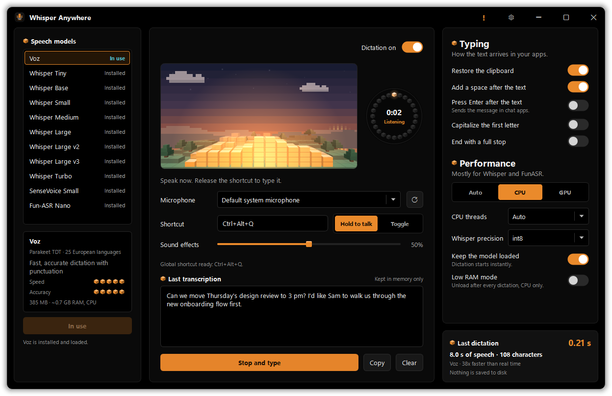
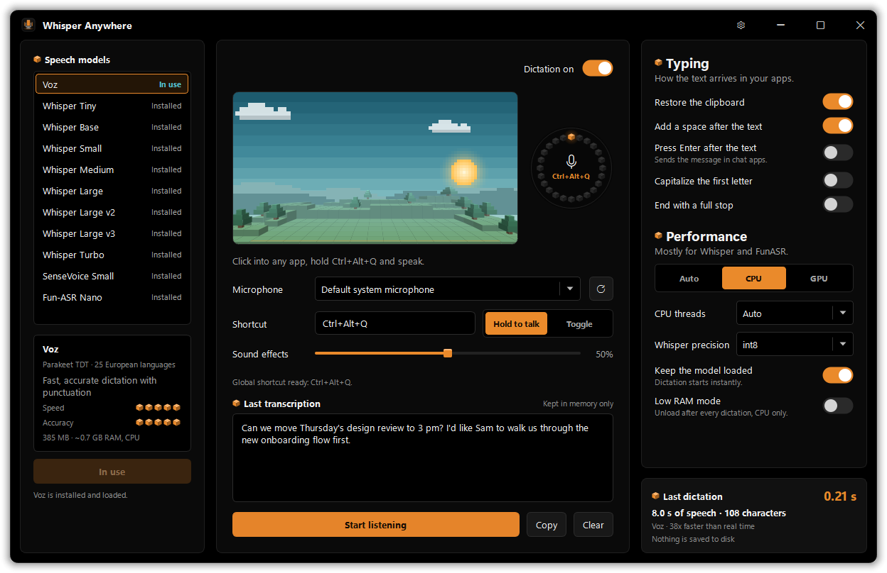
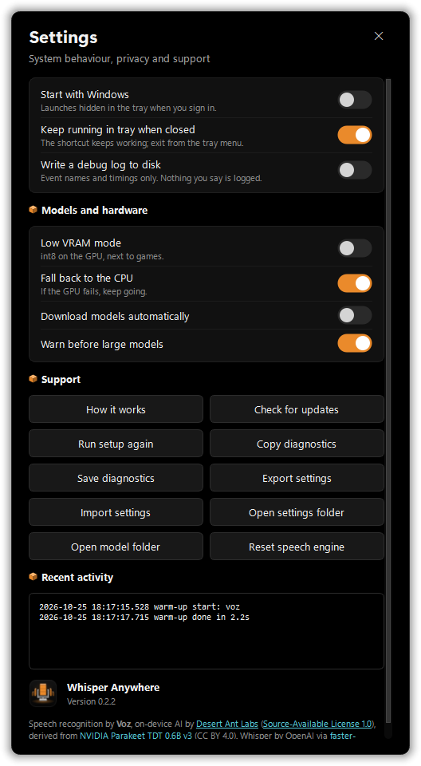

# Whisper Anywhere

Whisper Anywhere is a native Windows 11 desktop/tray app for local voice typing. It transcribes speech on your PC with a local speech model, Voz by default, then pastes the result into the app you were using.

Click in any app, hold `Ctrl + Alt + Q`, speak, release, and Whisper Anywhere transcribes your speech locally with the selected speech model.

This is not a web app and it does not use a cloud API. Recordings stay in memory and are never written to disk.



<table>
<tr>
<td></td>
<td width="34%"></td>
</tr>
</table>

## Download

**[Download WhisperAnywhere-Setup-0.2.5.exe](https://github.com/aSimpleLife-Lab/whisper-anywhere/releases/download/v0.2.5/WhisperAnywhere-Setup-0.2.5.exe)**: one installer, no administrator rights needed, Windows 10/11 64-bit.

1. Run the installer. The app is not code-signed yet, so Windows SmartScreen may say it "protected your PC": click **More info**, then **Run anyway**.
2. Start Whisper Anywhere from the Start menu. A five-step tour shows how it works; the orange **!** in the title bar replays it.
3. Click into any app, hold `Ctrl + Alt + Q` (or the mouse button you pick), speak, and let go.

The app downloads speech models on first use (Voz is about 385 MB), so the first setup takes a little while.
To launch automatically after reboot, click the gear in the title bar and turn on **Start with Windows**.
The installer build includes Voz and every Whisper model. SenseVoice and Fun-ASR need the optional FunASR engine, which is too large to ship in the installer; build from source with FunASR installed to use them.

## Developer Update Log

<details>
<summary><strong>Current build - v0.2.6</strong> - a full bug hunt: about fifty fixes, and the features it pointed to</summary>

New:
- **Free memory** (Performance) replaces Keep the model loaded and Low RAM mode: never, after 5, 15 or 60 idle minutes, or after every dictation. Low RAM mode reloaded the model for every dictation: about 2 s slower each time, a mouse shortcut that leaked out as a real click while it reloaded, and an 80 ms freeze of all input as it unloaded. Low RAM mode now becomes "after 5 idle minutes", and freeing the model no longer freezes input
- **App profiles** (Settings): for one app, paste or type, the key that sends (Enter, Ctrl+Enter or nothing) and the full stop. Type suits games that ignore Ctrl+V; Nothing keeps Enter from running a terminal command
- **Type the last dictation again**: `Ctrl + Alt + V` types your last dictation into the app in front, for 5 minutes after you speak. Change it or turn it off in Settings
- A quick tap of a mouse-button shortcut stays a normal click (M3 still opens links in new tabs); only a hold dictates
- **Esc** also cancels after you let go: while your speech is turned into text, it goes to Last transcription instead of being typed; while it types, typing stops. While you record, Esc no longer reaches the game, so its menu doesn't open. Cancelling and errors have their own sounds
- Long dictations: speech longer than 15 s is cut into overlapping windows and joined where the words agree, as the official Voz pipeline does. In six test passages the joins went from 8 wrong (a false full stop, a wrong capital or a doubled word, sent as-is with Enter on) to none

Fixed, pasting:
- Pasting is confirmed: Windows tells Whisper Anywhere when the app actually reads the text, and only then is your old clipboard put back and Enter pressed. A busy Discord or browser tab could paste and send your old clipboard; v0.2.5's check asked the wrong window. If the app never reads it, Enter is not pressed and the error sound plays
- The window is checked before every key: an Alt+Tab caught mid-paste took the paste and the Enter. If the chat changed while it transcribed (another Discord channel or browser tab), the text is pasted but Enter is not pressed
- Whisper Anywhere's own windows are never typed into; Enter used to click their buttons
- A held Shift, Alt or Win no longer turns the paste or Enter into a shortcut (Shift+Enter is a newline in Discord, Alt+Enter toggles full screen in games)
- An app running as administrator now gets a clear message instead of "Done", and Ctrl+V works on non-Latin keyboard layouts
- Copied files and EMF pictures survive the clipboard restore, and the restored clipboard no longer shows up again in Win+V history or clipboard monitors
- **End with a full stop** no longer adds one after "…", ",", ":", "。" or quotes, and capitalisation no longer turns "10am" into "10Am"

Fixed, the shortcut:
- Holding the shortcut longer than 60 s typed the first part and pressed Enter while you were still talking. A hold now lasts up to 5 minutes, and a shortcut that seems stuck stops the recording and keeps the text untyped
- The shortcut could stop working while the app said it was ready: an error in the hook ended it, and Windows drops hooks that answer too slowly. It now hooks itself in again, also after unlock and sleep
- Ctrl+Alt+Esc could be saved and cancelled itself; a bare Enter, Space or letter is refused, and setup now asks about risky shortcuts as the main window does
- First-run setup's shortcut box started real dictations, whose paste and Enter could save Enter as your shortcut

Fixed, microphone, models and engines:
- After a USB or Bluetooth microphone came or went, the saved microphone could quietly record from another one, and one failed re-scan left dictation dead until a restart
- A quick tap of the shortcut said "No microphone audio was captured"; it now says it was too short
- Turning **Dictation** off mid-recording left the microphone recording
- A failed write of a small model marker threw away a finished dictation, and picking a model during a download or dictation marked the wrong one installed
- Whisper's first download, and every SenseVoice and Fun-ASR load, went online with the shortcut off and no timeout. They now download first, with timeouts. SenseVoice and Fun-ASR models now live in the model folder: they download once more, and the old copies in `%USERPROFILE%\.cache\huggingface\hub` can be deleted. SenseVoice no longer types emoji
- Model sizes in the list were two to four times too small
- Voz's CPU copy of the model is checked against the model files, so a model update can no longer leave every dictation empty, and a damaged copy rebuilds itself. Downloads are checked against the published checksums, not just their size

Fixed, settings, startup and privacy:
- **Start with Windows** showed on while Task Manager had turned it off, and any copy of the app took over the startup entry. The switch now shows what Windows will do and says when Task Manager turned it off; switching it on turns it back on there too. Uninstalling only removes the entry if it points at the installed app
- An unreadable settings file silently reset everything. It is now kept as `settings.json.broken` and the last good copy, `settings.json.bak`, is used; a bad value resets only itself
- A leftover v0.1 log that was read-only or open in another program, or a model folder on a missing drive, stopped the app from starting
- Two copies could run when one ran as administrator
- Diagnostics and exported settings included your Windows user name
- First-run setup and the tour popped up on a hidden sign-in start when the settings file was missing

Lighter:
- About 15–35% less CPU per Voz dictation, at the same speed: ONNX Runtime's threads now spin only briefly while they wait, instead of keeping every core busy
- numpy no longer starts 23 idle threads and commits 747 MB
- The listening animation draws its equaliser once per step instead of every frame, two to three times cheaper, and it no longer stays at full speed after an error
- The model list no longer checks the model folders on every repaint

Smaller fixes: dragging Settings by a switch row no longer flips the switch, a refused model pick from the tray menu no longer stays ticked, focused segment buttons show a focus ring, Settings opens fully on screen, the window comes back on screen after its monitor is unplugged, and an error with no message is no longer blank

</details>

<details>
<summary><strong>v0.2.5</strong> - the other seventeen fixes from the code review</summary>

- Privacy: v0.1 kept the text of every dictation in `activity.log`, and no later version removed it. It is now overwritten and deleted on the first start, along with any recording a crash left in the temp folder
- Fixed: an app that was still busy when the dictation was pasted could read your old clipboard instead, restored too early, and with **Press Enter after text** on, send it. The old clipboard now only comes back once the app answers again, and it is no longer lost when a clipboard manager holds the clipboard for a moment or the paste fails
- Fixed: with a one-key shortcut such as Enter or V, the app's own paste and Enter could start a new recording
- Fixed: a settings file saved with a BOM (PowerShell 5.1) reset every setting, and one saved as ANSI (Notepad) stopped the app from starting
- Fixed: importing settings showed **Start with Windows** off while Windows kept starting the app, and left the debug log running against its switch. Start with Windows now stays this PC's own choice
- Fixed: importing settings exported from a PC with its own model folder made the next shortcut press download Voz into the app's folder
- Fixed: after importing settings or running setup again, **Dictation** showed on while a paused shortcut stayed off
- Fixed: **Run setup again** put the old microphone straight back and switched Press mode back to Hold
- Fixed: settings kept from v0.1 (its presets, its "Use GPU" box, thread counts the menu no longer offers) still changed how speech was recognised while the window showed something else
- Fixed: when the GPU could not be used (the installer build lacks part of NVIDIA's CUDA libraries), every dictation tried it again before falling back to the CPU. It now stays on the CPU until you change a setting
- Fixed: a model download slower than about 3.4 Mbit/s was called "took too long" after 15 minutes while it was still arriving. Only a download that stops arriving for 5 minutes fails now, and two downloads never write the same file
- Fixed: when a finished Voz download could not be moved into place, every later try failed with error 416
- Fixed: after a tap with no speech, "No speech was detected" stayed the status of every later Voz dictation
- Fixed: forcing Chinese on SenseVoice (source builds) quietly detected the language instead
- Fixed: running from source with **Start with Windows** on broke the installed app's autostart
- Tests: the check that recordings never touch the disk now also watches the temp folder, where v0.1 wrote them

</details>

<details>
<summary><strong>v0.2.4</strong> - fifteen fixes from a full code review</summary>

- Fixed: after changing a Performance setting, picking a model from the tray, resetting the speech engine, importing settings or running setup again, the v0.2.3 freeze fix stopped applying until the app restarted, so the mouse and keyboard froze again while a model loaded
- Fixed: on keyboards with AltGr (German, French and others), typing @ or another AltGr character could start dictation, because Windows sends AltGr as Ctrl+Alt
- Fixed: opening the app from the Start menu while it already ran in the tray started a second copy, and every dictation was pasted twice. The running copy's window now comes forward instead
- Fixed: if you switched to another window while your speech was transcribed, the text went into that window, and with **Press Enter after text** on it was sent there. It is no longer typed; copy it from **Last transcription**
- Fixed: after Ctrl+Alt+Del, a UAC prompt or the lock screen, Ctrl or Alt could stay "held", so a plain Q started dictation and a Ctrl+mouse shortcut swallowed ordinary clicks
- Fixed: a bad shortcut in an imported settings file stopped the app from starting at every sign-in. Imports now refuse it, and a bad saved one falls back to Ctrl+Alt+Q
- Fixed: the start sound played even when dictation could not start (for example while the last one was still typing), so you spoke into nothing. The sounds now play when the microphone really opens and closes, also for the mic button and the tray. In Press mode a refused start no longer costs an extra press, and Esc cancels any recording
- Fixed: pressing the shortcut before a large model was downloaded could open a dialog over a full-screen game, one more with each press. Large models are now confirmed once, when you pick them
- Fixed: **Copy**, Ctrl+C and right-click Copy in **Last transcription** now keep your words out of Windows clipboard history (Win+V) and cloud clipboard sync, as typed text already was
- Fixed: SenseVoice and Fun-ASR (source builds) wrote each recording to a temporary file; they now get it in memory, like Voz and Whisper
- Fixed: every Whisper model load contacted huggingface.co, which could hang on a blocked network. Downloaded models now load offline
- Fixed: a headset that connected after Windows started was never found, and the saved microphone was replaced by the default for good. The saved choice now stays, and the app looks for microphones again when it is missing, when the microphone fails to start, and from the refresh button
- Fixed: Voz could cut dictations longer than 15 seconds in the middle of a word
- Fixed: with **Keep running in tray when closed** off, closing the window left the app running in the background
- Build: a failed build no longer reports success or gets packaged into the installer

</details>

<details>
<summary><strong>v0.2.3</strong> - no more frozen mouse and keyboard while a model loads</summary>

- Fixed: while a speech model loaded, clicks and key presses stopped working across the whole PC for a few seconds, and longer on a busy PC. This happened at startup, when switching models, and after every dictation with **Low RAM mode** on. Windows waits for the app's shortcut hooks before it delivers any click or key press, and loading a model kept them from answering. The hooks now step aside for the few seconds a model takes to load

</details>

<details>
<summary><strong>v0.2.2</strong> - a tour of the app</summary>

- **New tour**: five short steps explain the shortcut, what the window shows while it listens, the speech models, the typing options (including games) and the sounds, privacy and tray. It shows once, after setup or the first time the window opens after updating, never on a hidden start in the tray
- An orange **!** in the title bar replays the tour (hover it: "Would you like to replay the tutorial?"), and so does **How it works** in Settings

</details>

<details>
<summary><strong>v0.2.1</strong> - model downloads that work on more networks, and say why when they cannot</summary>

- Fixed: on networks that block or silently drop traffic to Hugging Face (firewalls, antivirus, VPNs, DNS filters), the Voz download sat at "0 of 384 MB" for minutes and then only said to check the internet connection
- Voz now downloads with its own resumable downloader: a stalled connection gives up after 30 seconds (three tries), an interrupted download resumes where it stopped, and the progress line says "Connecting" until data arrives
- Download errors name the cause (no reply, DNS lookup failed, connection refused, secure connection blocked, or an HTTP error) and link to the files, so Voz can also be downloaded in a browser and dropped into the model folder
- Whisper model errors also name the underlying cause

</details>

<details>
<summary><strong>v0.2.0</strong> - Voz speech model, new interface, faster and more private</summary>

- **Voz** ([desert-ant-labs/voz](https://huggingface.co/desert-ant-labs/voz), NVIDIA Parakeet TDT 0.6B v3) is the new default model: punctuated, capitalized text in 25 European languages, on the CPU, no GPU needed
- Voz runs on ONNX Runtime with graphs rewritten for desktop CPUs (length-sized encoder windows, single-lane decoding, float32). On a Ryzen 9 5950X a 3 s clip transcribes in 0.12 s, 8 s in 0.2 s, 36 s in 0.9 s
- New interface with LumaDeck's layout in OLED black and orange: a frameless window with its own title bar, three panels that fit without scrolling, pill toggles, and a **voxel scene** that follows the time of day (pixel sun, moon in its real phase, voxel clouds and pines). Its front is a voxel equaliser: your voice raises glowing columns that roll back into the distance, and a cyan scanner runs while the model works. A voxel mic wheel shows the recording time, and the gear opens the settings window
- **Mouse buttons as the shortcut**: bind M3, M4 or M5 (or M1/M2 with a modifier, such as Ctrl+M1). The bound button is held back from other apps, so M4 starts dictation instead of going Back in the browser
- **Types into games**: in full-screen apps the text is typed in as characters instead of pasted, because most game chat boxes ignore Ctrl+V. Elsewhere the paste keys are held long enough for games that read the keyboard once per frame
- **New voxel sounds** made for the app (`scripts/make_cues.py`): the start cue lands a block and steps up a chiptune staircase with a chord sparkle and echo, the stop cue steps down and settles. A **Sound effects** slider sets their volume, and 0 turns them off
- **New voxel icon** for the app, taskbar, tray and installer, with hand-placed pixel art at 16 px (`scripts/make_icon.py`)
- **Fits any screen**: the window opens at its full size where there is room and fits smaller screens otherwise; on short screens the panels and the settings window scroll instead of squeezing and clipping text. Sharp at 125/150/200 % display scaling
- **Installer**: one setup .exe that installs per user without administrator rights
- The installed model now loads in the background at startup, so the first dictation is as fast as the rest
- Recordings stay in memory; nothing you say is written to disk or logged. Logs live in memory unless **Write a debug log to disk** is on, and pasted text is marked private so clipboard history and clipboard monitors skip it
- Fixed: Ctrl+letter shortcuts such as Ctrl+Shift+D never triggered, because Windows reports a control character instead of the letter while Ctrl is held
- Fixed: **Restore the clipboard** lost copied images and rich text, and could put the old clipboard back before slow apps (browsers, Electron apps) had pasted. It now restores every format a moment later, and only if you have not copied something new
- Fixed: the chosen microphone was remembered by device number, which changes when devices are plugged in, so dictation could record from the wrong one. It is now found by name
- Fixed: long dictations timed out after 90 s and lost their text; the limit now grows with the recording
- Fixed: typing a long text froze the window until it finished; it now types in the background
- Fixed: buttons in the settings window cut off the bottom of their labels
- Fixed: pasting while the shortcut's Alt/Shift/Win keys were still held sent Ctrl+Alt+V instead of Ctrl+V
- Fixed: **Press Enter after the text** pasted a newline instead of pressing Enter, so chat apps never sent the message
- Fixed: a silent tap of the shortcut unloaded the model, so the next dictation had to reload it
- Fixed: Whisper on the CPU used only 4 threads; Auto now uses one per physical core
- Faster pasting: no focus-restore delay when you never left the target app
- The microphone list shows each device once; Windows exposed every microphone up to four times
- **Dictation on** switch pauses and resumes the global shortcut without closing the app

</details>

<details>
<summary><strong>v0.1.1</strong> - setup, updates, microphone, diagnostics, and portable settings</summary>

- Proper native Windows app, taskbar, tray, and EXE icon
- Bundled custom start/stop feedback sounds
- Click-to-record shortcut selection, including single-key shortcuts
- Performance / Hardware settings save safely without breaking shortcuts
- Feature list dropdown inside the app
- Safer settings dropdowns that ignore mouse-wheel changes until opened
- Optional **Start with Windows hidden in the tray**
- In-app version display, manual update check, first-run setup with a run-again button, microphone fallback, diagnostics export, portable settings import/export, and optional installer script
- Dedicated `pytest` test suite for core settings, transcription runtime logic, audio recorder behavior, and text insertion flow

</details>

<details>
<summary><strong>v0.1.0</strong> - first public Windows release</summary>

- Reliable hold-to-talk voice typing with `Ctrl + Alt + Q`
- Local `faster-whisper` transcription with CPU-safe defaults
- Custom start and stop sounds
- System tray controls and downloadable Windows build

</details>

## Features

- Native PySide6 window with LumaDeck's layout in OLED black and orange: frameless shell, custom title bar, three panels
- Voxel scene that follows the time of day, with a voxel equaliser that shows your voice while you speak, plus a voxel mic wheel
- System tray support; the tray icon turns orange while listening and cyan while working
- Global hold-to-talk shortcut: `Ctrl + Alt + Q` or a mouse button (M3, M4, M5, or M1/M2 with a modifier), with optional toggle mode and a pause switch
- Click-to-record shortcut selection
- First-run setup for shortcut, model, microphone, and CPU/GPU choice, plus **Run setup again**
- A five-step tour after setup, replayed from the orange **!** in the title bar or **How it works** in Settings
- Microphone selection
- Local settings file at `%APPDATA%\Whisper Anywhere\settings.json`
- Speech models: **Voz** (default), Whisper Tiny, Base, Small, Medium, Large, Large v2, Large v3, Turbo, plus optional FunASR SenseVoice Small and Fun-ASR Nano
- Model list with install state, speed and accuracy ratings, size, and resource needs
- Hardware controls for Auto, CPU, GPU, Whisper precision, CPU threads, fallback, Low VRAM mode and when to free the model's memory
- The installed model loads in the background at startup and stays loaded for instant dictation, or is freed after the idle minutes you pick
- Download progress for Voz, with the UI responsive throughout
- Local transcription with Voz (ONNX Runtime) or `faster-whisper`, with optional local FunASR support
- Clipboard paste insertion into the focused Windows app, and typed text in full-screen games, confirmed before Enter is pressed
- App profiles: paste or type, the send key and the full stop, per app
- Restores the previous clipboard (text, rich text, images and copied files) once the app has read the paste
- A shortcut that types the last dictation again, and Esc to cancel until the text is typed
- Mouse-button shortcuts that dictate while held and stay a normal click when tapped
- Voxel start, stop, cancel and error sounds, preloaded for instant playback, with a volume slider
- Optional Windows startup launch hidden in the tray
- Manual **Check for updates** button that opens the GitHub release page when a newer release is available
- Safe diagnostics copy/save for support, with personal paths sanitized and no transcripts
- Portable settings export/import for moving settings to another PC
- One-file installer for sharing (Inno Setup, per user, no administrator rights)
- Fits any screen size and display scaling; panels scroll only when the screen is too small
- Dropdowns that do not change settings while you are just scrolling the page
- Automatic local folder creation
- Automatic selected-model preparation/download when enabled
- Clean shutdown of tray, keyboard hook, and microphone resources

## Normal User Workflow

After the app is built into an EXE, the user should not need to install Python, run pip, download models manually, configure environment variables, or start background scripts.

1. Open `Whisper Anywhere.exe`.
2. The app creates its local settings and model folders.
3. The app checks the selected speech model.
4. If the model is missing, the app prepares/downloads it automatically when enabled.
5. Click into any text field or app.
6. Hold `Ctrl + Alt + Q`.
7. Speak.
8. Release `Ctrl + Alt + Q`.
9. Text appears where the cursor was.

## Voz

[Voz](https://huggingface.co/desert-ant-labs/voz) by Desert Ant Labs is NVIDIA Parakeet TDT 0.6B v3 converted for on-device use. It writes punctuated, capitalized text in Bulgarian, Croatian, Czech, Danish, Dutch, English, Estonian, Finnish, French, German, Greek, Hungarian, Italian, Latvian, Lithuanian, Maltese, Polish, Portuguese, Romanian, Russian, Slovak, Slovenian, Spanish, Swedish, and Ukrainian. For other languages, pick a Whisper model.

Voz's official SDKs run its pipeline in a Swift/WebAssembly core, so Whisper Anywhere reimplements that part in Python (`src/core/voz_engine.py`): the fused mel frontend layout, TDT greedy decoding, and speech longer than 15 s cut into full 15 s windows that overlap by up to 3 s, each starting at the quietest moment, and joined where at least two words agree, as the official pipeline does. The first load rewrites the published ONNX graphs once for desktop CPUs (`src/core/voz_graphs.py`) and checks that copy against the model files on every later load:

- the encoder only processes as much audio as you recorded instead of a fixed 15 s window,
- the decoder runs one lane per window instead of a fixed 16,
- float16 math becomes float32, which this CPU path runs faster.

Measured on a Ryzen 9 5950X with 16 threads, against the published graphs:

| Clip | Published graphs | Rewritten graphs |
| --- | --- | --- |
| 3.3 s | 0.44 s | 0.12 s |
| 8 s | 0.51 s | 0.21 s |
| 36.5 s | 1.45 s | 0.90 s |

The bundle (about 385 MB) downloads into the model folder the first time Voz is used, pinned to a known revision.

## Performance / Hardware

Voz always runs on the CPU and needs no tuning. The **Performance** panel mostly matters for Whisper and FunASR:

- **Auto / CPU / GPU**: where Whisper and FunASR run. GPU needs a compatible CUDA setup; with **Fall back to the CPU** on, a GPU failure continues on the CPU.
- **CPU threads**: Auto uses one thread per physical core. Going past that (hyper-threads) slows speech models down.
- **Whisper precision**: Auto picks int8 on the CPU and float16 on the GPU.
- **Free memory**: Never keeps the model loaded, so dictation starts instantly. After 5, 15 or 60 idle minutes frees its memory (about 0.6 GB for Voz) until you dictate again, which then takes a couple of seconds longer. After every dictation frees it each time.
- **Low VRAM mode**: int8 on the GPU, to fit next to games or other AI apps.

## Optional FunASR Support

FunASR support is wired in as an optional local engine. Whisper remains the default so existing installs keep working.

Available FunASR model cards:

- `sensevoice-small`: `FunAudioLLM/SenseVoiceSmall`, a fast multilingual FunASR model for Chinese, English, Japanese, Korean, and Cantonese dictation.
- `funasr-nano`: `FunAudioLLM/Fun-ASR-Nano-2512`, a larger FunASR model with broader multilingual coverage.

Install the optional runtime in the source checkout:

```powershell
.\scripts\install_funasr.ps1
```

The installer uses CUDA PyTorch wheels when `nvidia-smi` is available, or CPU PyTorch with `-CpuOnly`.

Verify the full local path:

```powershell
.\scripts\test_funasr_live.ps1
```

The first run includes model load time. Later runs reuse the warmed model unless **Free memory** is set to after every dictation, which is the path where FunASR's speed advantage shows up.

Then pick a FunASR model in the model list and click **Download and use**. FunASR models download into the model folder's `funasr` subfolder before they load, and a downloaded model loads without going online. On Windows, the app enables the OS certificate store for downloads so Hugging Face downloads work on systems where Python's bundled certificate store misses a local root certificate.

FunASR transcribes speech in the language spoken.

## Developer Setup From Source

These steps are only for building or developing the app from the GitHub source code. End users should use the built EXE.

### 1. Clone the repo

```powershell
git clone https://github.com/aSimpleLife-Lab/whisper-anywhere.git
cd whisper-anywhere
```

### 2. Create a virtual environment

```powershell
py -3.11 -m venv .venv
.\.venv\Scripts\Activate.ps1
```

### 3. Install dependencies

```powershell
pip install -r requirements.txt
```

### 4. Install test dependencies

```powershell
pip install -r requirements-dev.txt
```

### 5. Run the app

```powershell
python .\src\main.py
```

### 6. Run the automated tests

```powershell
pytest
```

The `tests\` suite covers `SettingsManager`, mocked `Transcriber` runtime logic, `AudioRecorder`, mocked `TextInserter` clipboard behavior, and the Voz pipeline (input layout, window splicing, TDT decoding) without launching the Qt UI. To also run the real-model Voz tests, set `WA_VOZ_TEST_MODELS` to a copy of a model folder (it holds `voz\web`); they rewrite that copy's CPU graphs, so never point it at the folder the app uses.

### 7. Run lint and formatting checks

```powershell
ruff check src tests
ruff format --check src tests
```

`requirements-dev.txt` includes `pytest`, `pytest-mock`, and `ruff` so local quality checks stay separate from the packaged EXE dependencies.

## How To Test The Shortcut

1. Start Whisper Anywhere.
2. Wait until the selected model says it is ready. The first model preparation can take a while because it downloads model files.
3. Open Notepad or PowerShell.
4. Click where text should appear.
5. Hold `Ctrl + Alt + Q`.
6. Speak a short sentence.
7. Release `Ctrl + Alt + Q`.
8. The transcribed text should paste into the app you clicked.

If a Windows-key shortcut is flaky on your system, switch back to the default `Ctrl + Alt + Q`. You can change the shortcut in the app.

## Hotkey Diagnostics

Whisper Anywhere keeps an in-memory event log: hotkey starts, stops and key transitions, recordings, timings and errors. It never contains what you said. Open it from the gear in the title bar under **Recent activity**, or include it in **Copy diagnostics**. To keep it on disk while troubleshooting, turn on **Write a debug log to disk**, which writes:

```text
%APPDATA%\Whisper Anywhere\debug.log
```

The main window also shows the current hotkey status under the shortcut. For reliability testing, compare:

- Default: `Ctrl + Alt + Q`
- Legacy comparison only: `Ctrl + Win + Space`, `Ctrl + Win`

`Ctrl + Alt + Q` is the recommended default because it avoids Windows-shell shortcuts while still giving a clean hold/release sequence. Windows-key shortcuts are still available, but they are less reliable across machines.

Developer shortcut test helper:

```powershell
.\scripts\test_hotkeys.ps1 -Mode Source -Shortcut Ctrl+Alt+Q
.\scripts\test_hotkeys.ps1 -Mode Source -Shortcut Ctrl+Win
.\scripts\test_hotkeys.ps1 -Mode Exe -Shortcut Ctrl+Alt+Q
.\scripts\test_hotkeys.ps1 -Mode Exe -Shortcut Ctrl+Win
```

The helper updates the local shortcut setting, starts the app, and opens Notepad while you press the shortcut. Turn on the debug log first if you want it to tail the events.

## Build The EXE

Run this on Windows 11:

```powershell
.\scripts\build_exe.ps1
```

The output will be:

```text
dist\Whisper Anywhere\Whisper Anywhere.exe
```

The EXE bundles Python and Python dependencies. Speech model files are not bundled because they are large; the app downloads/prepares the selected model automatically on first use and stores it locally. FunASR support requires building with the optional FunASR runtime installed.

## Build The Installer

The shareable installer is built from a lite app build that leaves out FunASR and PyTorch (about 5 GB). Install Inno Setup 6 once (`winget install JRSoftware.InnoSetup`), then run:

```powershell
.\scripts\build_installer.ps1
```

It runs `build_exe.ps1 -Lite` (output in `dist-lite\`) and creates `dist-installer\WhisperAnywhere-Setup-<version>.exe`, which installs per user under `%LOCALAPPDATA%\Programs\Whisper Anywhere` and removes the **Start with Windows** entry on uninstall.

The app icon and the start/stop sounds are generated: `python scripts\make_icon.py` writes `assets\icon.ico` and `assets\icon.png`, and `python scripts\make_cues.py` writes `assets\sounds\start.wav` and `stop.wav`.

## Versioning

The in-app version lives in `src\core\app_version.py`. Keep it aligned with this Developer Update Log and the GitHub release tag when preparing a public release.

## License

Whisper Anywhere is released under the [MIT License](LICENSE).

Speech models keep their own licenses and are downloaded, not bundled:

- **Voz**: on-device AI by [Desert Ant Labs](https://desertant.com), [Desert Ant Labs Source-Available License 1.0](https://license.desertant.com/1.0). It is free below 100,000 monthly active devices per platform; credit appears in the app's settings window. Voz is derived from [NVIDIA Parakeet TDT 0.6B v3](https://huggingface.co/nvidia/parakeet-tdt-0.6b-v3) (CC BY 4.0).
- **Whisper**: OpenAI, MIT, run with [faster-whisper](https://github.com/SYSTRAN/faster-whisper).
- **SenseVoice / Fun-ASR**: [FunASR](https://github.com/modelscope/FunASR) model licenses.

## AI Assistance

This project was built with assistance from AI coding tools, with final testing and release decisions handled by the maintainer.

## Local Files

Settings:

```text
%APPDATA%\Whisper Anywhere\settings.json
```

Models (Voz lives in its `voz` subfolder; it can be a folder link to another drive):

```text
%LOCALAPPDATA%\Whisper Anywhere\models
```

Recordings are never written to disk, with any engine.

Settings keep one backup of the last good file, `settings.json.bak`. A settings file that could not be read is kept as `settings.json.broken` (numbered if there are several) instead of being overwritten.

## Settings Defaults

```json
{
  "selected_model": "voz",
  "shortcut": "Ctrl+Alt+Q",
  "shortcut_mode": "hold",
  "hotkey_default_version": 3,
  "start_sound_path": "",
  "stop_sound_path": "",
  "retype_shortcut": "Ctrl+Alt+V",
  "insert_method": "auto",
  "app_profiles": {},
  "feedback_volume": 0.5,
  "device": "cpu",
  "compute_type": "int8",
  "runtime_default_version": 2,
  "use_gpu_if_available": false,
  "fallback_to_cpu": true,
  "low_vram_mode": false,
  "warn_before_large_models": true,
  "unload_model_after": "never",
  "cpu_threads": "auto",
  "auto_download_models": true
}
```

`unload_model_after` is `never`, `5`, `15`, `60` (idle minutes) or `each`. An app profile looks like this:

```json
"app_profiles": {
  "windowsterminal.exe": { "insert_method": "auto", "send_key": "none", "full_stop": "off" }
}
```

## Limitations

- No history page yet.
- No file transcription tab yet.
- No cloud API mode yet.
- No command replacements yet, so saying `slash` will transcribe as the word `slash` for now.
- Typing into elevated Administrator apps requires running Whisper Anywhere as Administrator too; it says so instead of typing.
- The retype shortcut is a key combination; mouse buttons can only be the dictation shortcut.
- The first model setup can take time and needs internet access.
- GPU mode needs a compatible CUDA setup; otherwise Auto/GPU Preferred can fall back to CPU.

## Troubleshooting

### No microphone found

Check Windows Settings > Privacy & security > Microphone and make sure desktop apps can access the microphone.

### Shortcut does not start recording

Check that **Dictation on** is switched on. The shortcut hooks itself in again when Windows drops it; if it still fails, restart the app or change the shortcut. Some security software may block global keyboard hooks.

### The app does not start with Windows

Open Settings: if it says Task Manager turned it off, switch **Start with Windows** on there, which turns it back on in Task Manager too.

### Text does not appear in the target app

Click into the text box first; in games, open the chat box before you speak. The status line says why the text didn't arrive, and the text stays in **Last transcription**: press `Ctrl + Alt + V` to type it again. For a game that ignores Ctrl+V, add an app profile with **Type**. If the target app or game runs as Administrator, Windows blocks other apps from typing into it, so run Whisper Anywhere as Administrator too. Some anti-cheat systems block typed input from other apps entirely.

### GPU does not work

Use `Auto` or `CPU`, or keep **Fall back to the CPU** on. GPU transcription requires compatible CUDA libraries for faster-whisper/ctranslate2.

### Model download fails

The message under the model list says why. The usual causes are a firewall or antivirus blocking Whisper Anywhere (allow it, or add it as an exception), a VPN or DNS filter, or a network that blocks huggingface.co.

You can also install Voz by hand: from [huggingface.co/desert-ant-labs/voz (folder web)](https://huggingface.co/desert-ant-labs/voz/tree/12802bf4e2b5e97e1289b723bc6283b6f1a1ace5/web), download `meta.json`, `vocab.json`, `embedding.f16`, `encoder.onnx`, `encoder.onnx.data` and `decoder.onnx` in your browser (the WebGPU decoder is not needed) and put them in `%LOCALAPPDATA%\Whisper Anywhere\models\voz\web`. The app notices them and shows Voz as installed.

Also check available disk space and permissions for `%LOCALAPPDATA%\Whisper Anywhere\models`.

## Disclaimer

<table>
<tr>
<td><h3><strong>I used AI coding tools as part of the workflow, but I’m maintaining, testing, and releasing the project myself.</strong></h3></td>
</tr>
</table>
